# PlantUML 类图教程（结合实验一）

## 1. 目标
本教程用于指导你在本项目中维护 `uml/Inheritence.puml`，并能独立同步实验迭代中的类图变更。

## 2. 快速开始
1. 安装 IntelliJ PlantUML 插件。
2. 打开 [Inheritence.puml](/Users/kuma/Project/AircraftWar-base1.0/uml/Inheritence.puml)。
3. 使用插件预览窗口实时查看图形。
4. 编辑后保存，确认预览无语法报错。

## 3. PlantUML 核心语法

### 3.1 定义类与可见性
```plantuml
class HeroAircraft {
  - {static} instance:HeroAircraft
  - HeroAircraft(int x, int y, int sx, int sy, int hp)
  + {static} getInstance():HeroAircraft
}
```
- `+` 公有
- `-` 私有
- `#` 受保护
- `{static}` 静态成员
- `{abstract}` 抽象方法

### 3.2 继承与依赖
```plantuml
AbstractAircraft <|-- EliteEnemy
Game ..> HeroAircraft : getInstance()
```
- `<|--`：泛化（继承）
- `..>`：依赖

### 3.3 抽象类
```plantuml
abstract class AbstractItem {
  + {abstract} activate(HeroAircraft heroAircraft):void
}
```

### 3.4 分组（按包）
```plantuml
package aircraft {
  class EliteEnemy
}
```

### 3.5 多页图

```plantuml
@startuml
...
newpage
...
@enduml
```

可把“继承总览”和“单例结构图”放在同一文件内的不同页面。

## 4. 本项目实验一同步清单
每次改代码后，按下面顺序同步 UML：
1. 看 `basic`：是否新增公共属性/方法。
2. 看 `aircraft`：敌机类是否增加，`HeroAircraft` 单例结构是否变化。
3. 看 `item`：抽象父类与子类是否齐全。
4. 看 `application/Game`：是否新增关键依赖关系（如掉落、管理列表、难度接口）。
5. 在图中补 `继承` 与 `依赖` 关系。

## 5. 本次实验一的图纸要点
- `HeroAircraft` 必须体现 DCL 单例：
  - 私有构造器
  - 私有静态实例
  - 公有静态 `getInstance()`
- 敌机体系包含：`MobEnemy`、`EliteEnemy`、`ElitePlusEnemy`、`AceEnemy`、`BossEnemy`。
- 道具体系包含：`AbstractItem` + 5 个子类。
- 显示 `Game` 对敌机/子弹/道具的依赖管理关系。

## 6. 常见错误
1. 漏写可见性（`+/-/#`）导致信息不完整。
2. 把依赖写成继承（`..>` 与 `<|--` 混淆）。
3. 单例类仍把构造器写为公有。
4. 代码已新增类，但图中遗漏（最常见）。

## 7. 建议流程
1. 先改代码。
2. `git diff` 看新增类/字段/方法。
3. 同步 `uml/Inheritence.puml`。
4. 用插件预览确认无语法错误。
5. 提交代码与 UML 在同一个任务分支。
